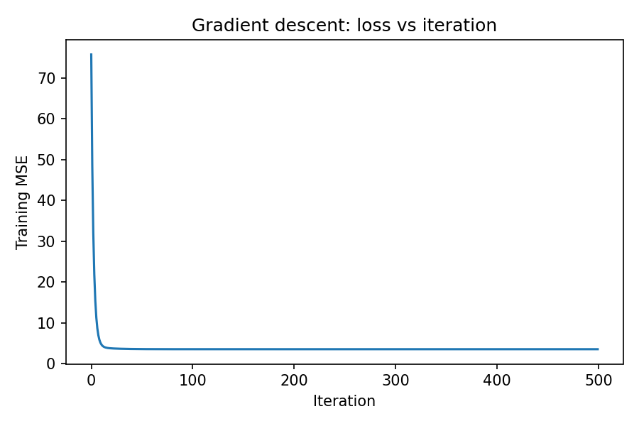

# Linear Regression from Scratch: How Much Do Earlier Grades Explain?

I implemented linear regression with gradient descent in NumPy and used it to ask a simple question: how much of a student's final maths grade can be predicted, with and without their earlier grades?

## Dataset

UCI Student Performance dataset, `student-mat.csv` (maths course): 395 students from two Portuguese secondary schools. Target: `G3` (final grade, 0 to 20). `G1` and `G2` are first- and second-period grades from the same year.

Source: Cortez, P. (2008). Student Performance [Dataset]. UCI Machine Learning Repository. https://doi.org/10.24432/C5TG7T (CC BY 4.0). The notebook downloads the data itself, so no data file is included here.

## Method

- Model: prediction = X·w + b
- Loss: mean squared error (MSE)
- Gradient derived by hand, then checked against a finite-difference estimate. The two agree to about 9 decimal places.
- Training: gradient descent with learning rate 0.1 on standardised features. Mean and standard deviation come from the training data only.
- Sanity check: the learned weights match Scikit-learn's `LinearRegression` (largest weight difference about 1e-7).
- Evaluation: an 80:20 train-test split (seed 42), then 5-fold cross-validation with scaling done inside each fold.
- Comparison model: Random Forest (200 trees, `random_state=42`).

## Results

Single 80:20 split, my model and Scikit-learn gave the same test scores on the five-feature setup: MAE 1.103, RMSE 1.892, R² 0.824.

5-fold cross-validation, R² (mean ± standard deviation across folds):

| Setup | Linear regression (mine, GD) | Random Forest |
|---|---|---|
| A: studytime, failures, absences, G1, G2 | 0.822 ± 0.038 | 0.860 ± 0.049 |
| B: numeric background features only (no G1, G2) | 0.087 ± 0.066 | 0.205 ± 0.074 |

Setup B uses: age, Medu, Fedu, traveltime, studytime, failures, famrel, freetime, goout, Dalc, Walc, health, absences.

On the single split, adding only G1 to the background features raised R² from 0.072 to 0.693.

## What I found

- Most of the predictable signal comes from earlier grades. Without G1 and G2, R² falls from about 0.82 to about 0.09 (linear) or 0.21 (Random Forest).
- With G1 and G2, Random Forest scored higher on average (0.860 vs 0.822) and won 4 of 5 folds, but the gap is about the same size as the fold-to-fold spread, so I treat the two as comparable.
- Without G1 and G2, Random Forest was higher in all 5 folds. One possible reason is non-linear effects of habits and background, but I did not test this.

## Limitations

- Setup B uses numeric columns only. The categorical columns (school, address, and so on) were left out, so B may be somewhat higher with them included.
- 5 folds of about 79 students give noisy estimates.
- G1 and G2 are same-year grades, so setup A is not an early-warning model.
- Results come from two schools and one subject, and may not generalise elsewhere.
- The hyperparameters (learning rate, number of iterations, Random Forest settings) were not tuned.

## How to run

1. Open `linear_regression_from_scratch.ipynb` in Google Colab.
2. Choose Runtime, then Run all. The first cell downloads the dataset from UCI.

## Author

Dishita Dutta, B.Sc. Mathematics (Honours), University of Delhi
